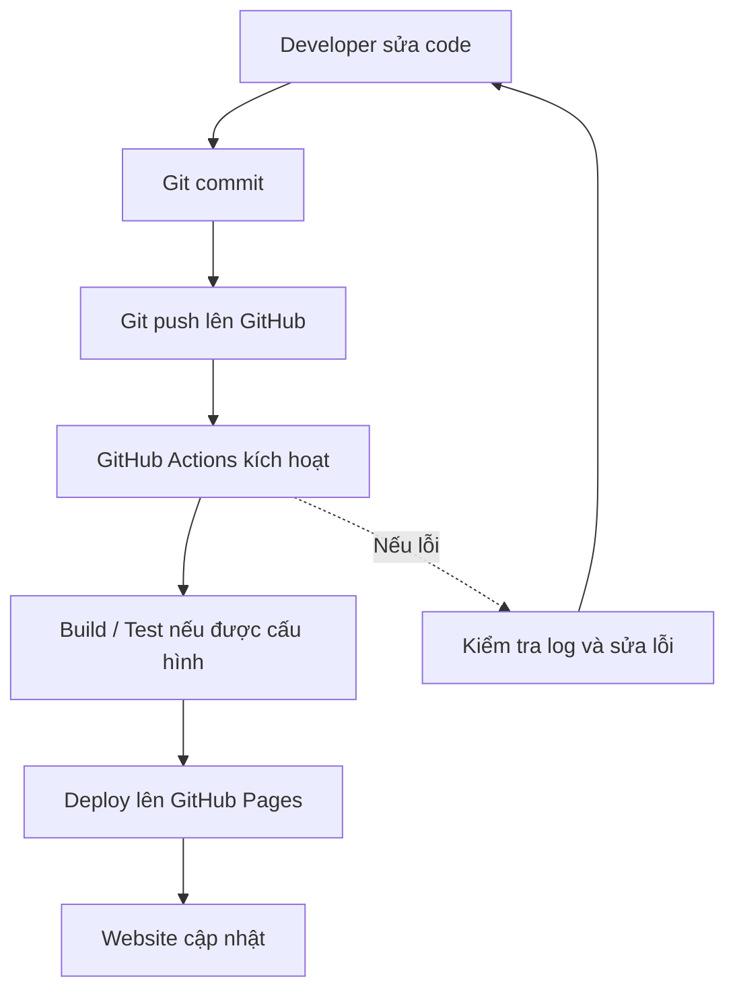

# Lab 1 - So sánh DevOps và Traditional

## 4.1. Bảng so sánh

| Tiêu chí                        | Traditional (Thủ công)                              | DevOps (CI/CD Pipeline)                                                      |
| ------------------------------- | --------------------------------------------------- | ---------------------------------------------------------------------------- |
| Làm sao để deploy?              | Tải file, upload lên server và cấu hình thủ công.   | Push code lên GitHub, GitHub Actions tự động chạy pipeline.                  |
| Mất bao lâu?                    | Khoảng 15–30 phút, tùy dự án.                       | Khoảng 10 giây đến vài phút, tùy pipeline.                                   |
| Ai làm deploy?                  | Lập trình viên hoặc quản trị viên hệ thống.         | GitHub Actions tự động thực hiện theo workflow đã cấu hình.                  |
| Có bị sai sót không?            | Dễ xảy ra lỗi do thao tác thủ công.                 | Giảm lỗi thao tác thủ công nhưng vẫn có thể phát sinh lỗi.                   |
| Rollback nếu lỗi?               | Khôi phục bản sao lưu hoặc upload lại phiên bản cũ. | Dùng `git revert` và push để pipeline triển khai lại phiên bản đã khôi phục. |
| Làm sao biết deploy thành công? | Kiểm tra website hoặc log trên server.              | Theo dõi trạng thái và log trong GitHub Actions, sau đó kiểm tra website.    |

## 4.2. DevOps Workflow



## 4.3. Trả lời câu hỏi

### Câu 1. DevOps workflow tự động hóa những bước nào?

DevOps workflow tự động hóa các bước được định nghĩa trong pipeline, chẳng hạn như lấy mã nguồn, build, test và deploy website. Với GitHub Actions, lập trình viên chỉ cần commit và push code lên GitHub để kích hoạt quy trình triển khai.

### Câu 2. Nếu deploy sai, làm sao để quay lại phiên bản cũ?

Có thể sử dụng `git revert` để đảo ngược commit gây lỗi, sau đó push lên GitHub. Pipeline sẽ chạy lại và triển khai phiên bản đã được khôi phục.

Ví dụ:

```bash
git log --oneline
git revert <commit_id>
git push origin main
```

### Câu 3. GitHub Actions giúp tiết kiệm bao nhiêu thời gian?

Theo ước tính của bài lab, deploy thủ công mất khoảng 15–30 phút, trong khi CI/CD có thể hoàn thành trong khoảng 10 giây đến vài phút. Pipeline giúp giảm thao tác lặp lại, hạn chế lỗi thủ công và tăng tính nhất quán khi triển khai.

Thời gian thực tế phụ thuộc vào cấu hình workflow và môi trường triển khai.

## 4.4. Kết luận

Qua bài lab, em hiểu được sự khác biệt giữa triển khai thủ công và CI/CD. GitHub Actions giúp tự động hóa quy trình triển khai website khi có thay đổi trên repository, đồng thời cung cấp log để theo dõi và xử lý lỗi. Đây là nền tảng quan trọng để tiếp cận quy trình DevOps trong các dự án thực tế.
